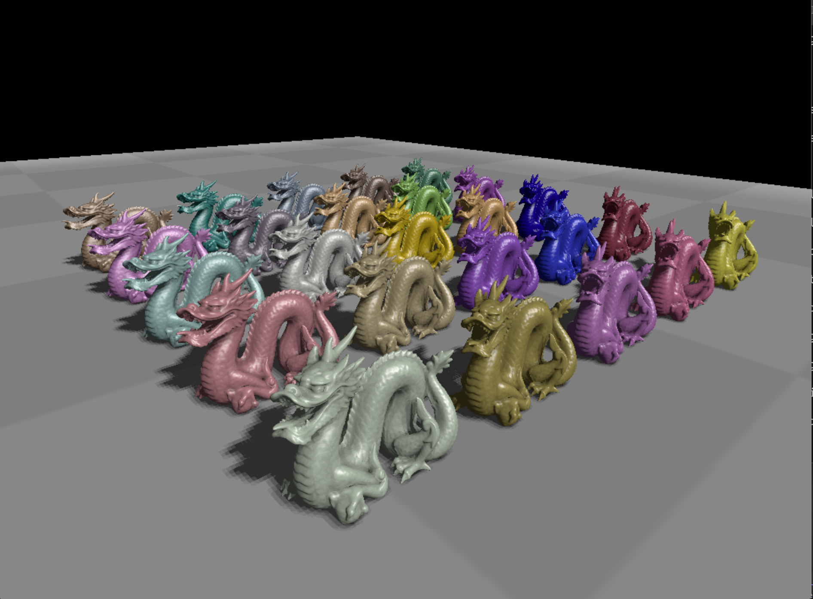
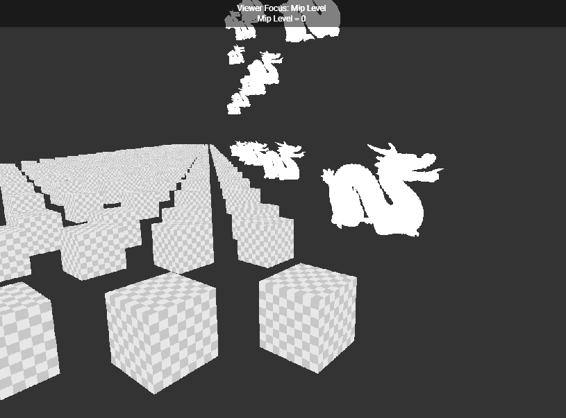
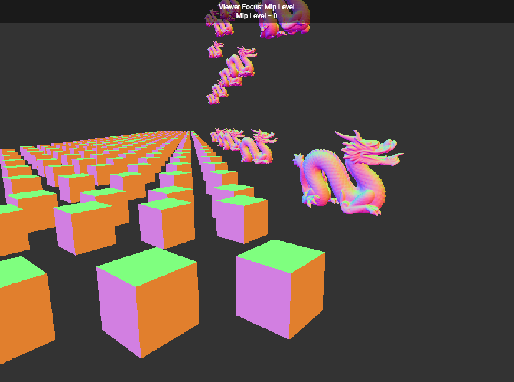
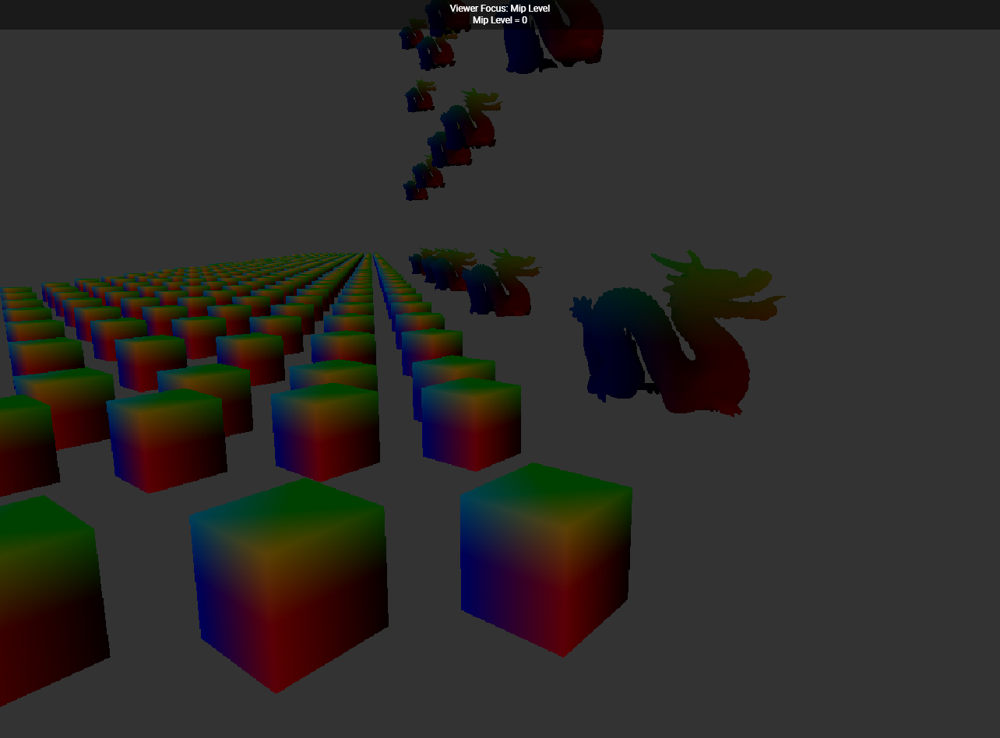

# Custom Game Engine

## Project Overview

A **C++17 Data-Oriented game engine built from scratch**, referencing the architecture of Unreal Engine.  
Implements core commercial-engine structures: **Runtime Reflection**, **Garbage Collection**, **ECS**, **MeshBatch instancing**, **PrimitiveProxy**, **RenderGraph**, and **RHI**.  
Every layer is directly controlled — custom containers, purpose-built allocators, and a multi-threaded worker pipeline.

## Design Documents

| Document | Contents |
|----------|----------|
| [Architecture Overview](Docs/Design_Architecture.md) | Module dependencies, project structure, design philosophy |
| [World / ECS](Docs/Design_World.md) | Entity, Component, Node, System, Scene, Commander |
| [Renderer / Lighting](Docs/Design_Renderer.md) | RenderPass, GBuffer, Phong lighting, Point/Directional light |
| [RHI](Docs/Design_RHI.md) | RHISystem, CommandList, FrameExecutor, GLSystem |
| [Asset Pipeline](Docs/Design_Asset.md) | Async 3-stage parse → load → upload pipeline |
| [Threading & Sequences](Docs/Design_Threading.md) | Worker threads, FrameGate, frame/asset sequences |
| [**Directional Shadow Mapping (TechNote)**](Docs/TechNote_DirectionalShadowMapping.md) | **Fundamentals, shimmering problem, texel snapping solution, implementation details, debugging** |

---

## 📸 Progress & Demo

**Milestone: Shadow Mapping — Texel Snapping Stabilization**  
Fixed directional light shadow map temporal stability (camera movement flickering):
- **Texel Snapping in Light Space**: Transform camera frustum center to light space, quantize to shadow map texel grid, reconstruct snapped world position
- **Light View Matrix Refinement**: Recompute view matrix based on snapped world position instead of raw frustum center → fixed shadow placement across frames
- **Frustum Bounding Sphere**: Calculate camera frustum AABB + bounding sphere for tight, camera-relative light frustum
- **Fixed Snap Grid Size**: `texelSize = frustumRadius * 2.f / shadowMapSize` correctly scales with frustum

Result: Shadow position quantized to fixed grid → eliminates temporal drift during camera movement.

*[26-06-25] Shadow Shimmering Fix — Texel snapping in light space*


---

**Milestone: Shadow Mapping — Directional Light (Slope-based Bias + PCF)**  
Directional Light shadow mapping fully implemented with:
- **Perspective → Light Space AABB**: Camera frustum transformed to light space, AABB calculated for tight shadow frustum
- **Slope-based Dynamic Bias**: `shadowBias = texelRatio × tangentRatio` (TexelSize + Surface Normal angle)
- **PCF (9-sample)**: Soft shadow edges via neighboring texel sampling
- **Border Color (GL_CLAMP_TO_BORDER)**: Range-out regions rendered as unshadowed (white border)
- **Far Plane Check & Margin Fade**: Boundary artifacts smoothed via `smoothstep()` blending

Remaining work:
- **Cascade Shadow Maps**: Multiple frustums for depth-dependent resolution
- **Spot/Point Light Shadows**: Omnidirectional cubemap shadow rendering

Resolved:
- **[Bug] Shadow Acne / NaN / Grazing artifacts**: Receiver Plane Depth Bias (RPDB) + Normal Offset + safe determinant (NaN-free) + grazing cutoff. See [Bug report](Docs/Bug_ShadowBlinking.md).

*[26-06-21] Directional Shadow — Slope-based Bias + PCF + Border Color*



---

**Milestone: Spot Light — Angular & Distance Attenuation**  
Spot Light implemented with `cosine-weighted` angular falloff between `innerAngle` and `outerAngle` (linear blend via epsilon factor).  
Distance attenuation via `falloff² / (dist² + 1)` (shared with Point Light).  
Angular cutoff calculated in fragment shader: `smoothstep(outerCos, innerCos, dot(rayDir, direction))`.  
Fixed angular conversion: `cos(radians(angle))` instead of erroneous `2π * angle / 180`.

*[26-06-02] Spot Light — Multiple lights with proper angle blending*


---

**Milestone: Phong Lighting — Directional & Point Light with GBuffer Phong**  
Replaced PBR with Phong shading (diffuse NdotL + specular RdotV + emissive).  
GBuffer extended with `tGPhong` (`R16G16B16A16_UInt`): specular packed in lower 8 bits, emissive in upper 8 bits per channel, shininess in alpha.  
Point light implements smooth distance attenuation with two-sided lighting via `incidentDir` correction.  
GLSystem extended with UInt pixel format support (`eR8_UInt` ~ `eR32G32B32A32_UInt`).  
**Known Issue:** [Point Light incident direction artifact](Docs/Issue_PointLight_IncidentDirArtifact.md) when light penetrates geometry.

*[26-05-28] Point Light — Phong shading with attenuation*


---

**Milestone: Hash Storm Fix — 1,000,000 Instance Dirty Tracking Optimization (×4.2 Throughput)**  
Per-instance `OnUpdate()` dirty-tracking storm eliminated. 2,000,000 hash operations per frame (World: 15.37%, RenderScene: 20.30%) collapsed to 1 call via dirty-state guard.  
Result: 1,000,000 instances at **~22 FPS (Release)** (prev: 5.4 FPS).

*[26-05-24] Hash Storm Fix — 1,000,000 Cube in release mode*


---

**Milestone: TransformPass — GPU Compute TRS (×10 Throughput)** TRS matrix computation (position/rotation/scale → mat4) moved from CPU (GLM scalar) to GPU via Compute Shader (`TransformPass`, `local_size_x = 64`).  
The render pipeline is now **TransformPass → GeometryPass → LightingPass**. Result: 100,000 instances at ~20 FPS (Release), 500,000 instances at ~10 FPS (Release). Previous baseline: 30,000 instances fell below 10 FPS in Debug.

*[26-05-24] GPU Compute TRS — 500,000 Cube in release mode*


---

**Milestone: Deferred Rendering Completed**  
Full deferred pipeline operational: GBuffer fill (geometry pass) → per-light shading (lighting pass).

*[26-05-21] Deferred Rendering — full pipeline demo*


*[26-05-21] GBuffer — Albedo / Normal / Position*

| Albedo | Normal | Position |
|:------:|:------:|:--------:|
|  |  |  |

---

**Milestone: Core Framework & Basic Rendering Completed**  
Core backbone, asset parsers, and foundational RHI rendering pipeline.

*[26-04-17] MeshBatch Instancing with Normal Mapping*


*[26-04-18] Base camera system*


---

## Implementation Status

| System | Status |
|--------|--------|
| ECS (Entity, Component, Node, System) | ✅ Complete |
| Memory (allocators, smart pointers) | ✅ Complete |
| Runtime Reflection | ✅ Complete |
| Container (Vector, HashMap, HashSet) | ✅ Complete |
| World / Commander / Scene | ✅ Complete |
| Worker System + FrameGate | ✅ Complete |
| RHI Layer (OpenGL 4.5, WGL) | ✅ Complete |
| RHI Command List + Triple Buffering | ✅ Complete |
| SceneProxy / LightProxy / MaterialProxy | ✅ Complete |
| MeshBatch Instancing (1M instances ~22 FPS Debug) | ✅ Complete |
| RenderGraph / RenderPass hierarchy | ✅ Complete |
| TransformPass (GPU TRS, 500k @ 20 FPS Release) | ✅ Complete |
| GeometryPass (GBuffer fill) | ✅ Complete |
| LightingPass — Directional Light (Phong) | ✅ Complete |
| LightingPass — Point Light (Phong + attenuation) | ✅ Complete |
| LightingPass — Spot Light (angular + distance attenuation) | ✅ Complete |
| GBuffer Phong (tGPhong UInt bit packing) | ✅ Complete |
| UInt Texture / usampler2D support | ✅ Complete |
| Asset System (OBJ, MTL, Async pipeline) | ✅ Complete |
| CullingPass (GPU frustum culling) | 🚧 Stub |
| [Shadow Map — Directional Light](Docs/Feature_DirectionalShadowMapping.md) (Slope-based Bias + PCF + Texel Snapping) | ✅ Complete |
| Shadow Map — Cascade Shadow Maps | 🚧 Planned |
| Shadow Map — Perspective Shadow Mapping | 🚧 Planned |
| Shadow Map — Spot/Point Light (cubemap) | 🚧 Planned |
| [Point Light: Incident Direction Artifact](Docs/Issue_PointLight_IncidentDirArtifact.md) | 🐛 Known Issue |
| [Shadow Acne / NaN / Grazing artifacts](Docs/Bug_ShadowBlinking.md) (RPDB + Normal Offset + safe det) | ✅ Resolved |
| GC (Mark & Sweep) full integration | 🚧 In progress |
| DirectX 11 / 12 RHI backend | 🚧 Planned |
| Physics integration | 🚧 Planned |

---

## Build Instructions

**Requirements:** Windows 10/11 (64-bit), MSVC (VS 2019+), C++17, CMake 3.15+

```bash
git clone --recursive https://github.com/Winteradio/Game-Engine.git
cd Game-Engine
mkdir build && cd build
cmake ..
cmake --build . --config Release
```

---

## Tech Stack

| Item | Details |
|------|---------|
| Language | C++17 |
| Graphics API | OpenGL 4.5 Core Profile |
| Windowing | WGL (Win32 API) |
| Math | GLM 1.0.1 |
| Build | CMake 3.15+ |
| Platform | Windows 10/11 |

---

## Assets & Credits

| Mesh | Source |
|------|--------|
| Dragon | Stanford 3D Scanning Repository |
| Sphere | melfm / openGL-shading-texture |
| Cube | Unknown |

---

## License

MIT License
